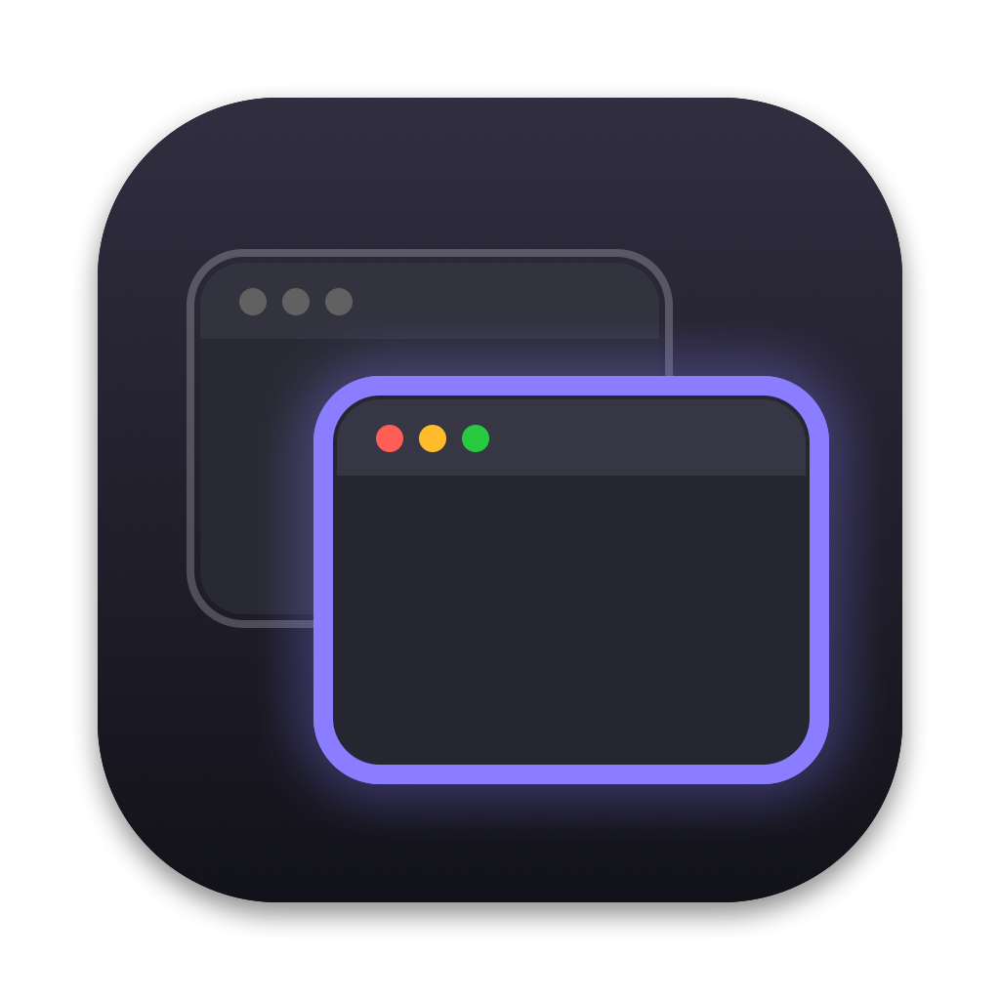
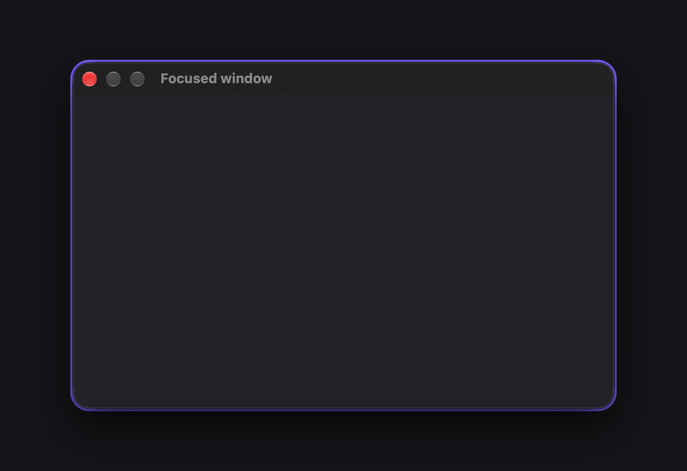
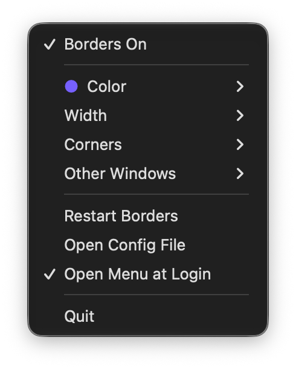
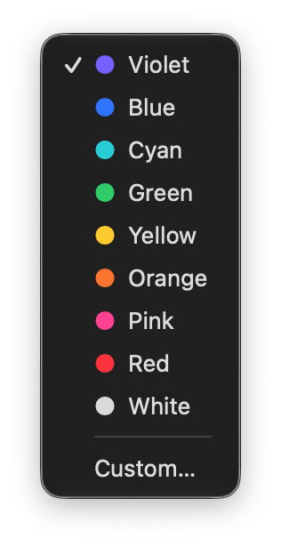

<p align="center">
  
</p>

# Borders Menu

A small macOS menu bar app for changing [JankyBorders](https://github.com/FelixKratz/JankyBorders) settings without editing its config file.

Pick a border color, width and corner style from the menu bar. Each change shows on your windows right away and is saved to `~/.config/borders/bordersrc`.

<p align="center">
  
</p>

<p align="center">
  
  &nbsp;&nbsp;
  
</p>

## Features

- **Borders On/Off**: starts or stops the JankyBorders service.
- **Color**: nine presets, or **Custom…** to pick any color with the macOS color picker.
- **Width**: 2, 3, 5, 8 or 12 points.
- **Corners**: round or square.
- **Other Windows**: no border, a faint white border or a dim gray border on windows that aren't focused.
- **Restart Borders**: brings borders back when they disappear (see [Known issues](#known-issues)).
- **Open Config File**: opens `bordersrc` in TextEdit.
- **Open Menu at Login**: starts Borders Menu when you log in.

Borders Menu only writes the config file and passes the settings to the running `borders` process. JankyBorders keeps drawing the borders. Quitting the menu doesn't stop them.

## Requirements

- macOS 13 or later, on Apple Silicon. The build script installs to `/Applications` and calls Homebrew under `/opt/homebrew`.
- [Homebrew](https://brew.sh) and JankyBorders, run as a Homebrew service:

  ```bash
  brew install FelixKratz/formulae/borders
  brew services start borders
  ```

- Xcode or the Command Line Tools (`xcode-select --install`) to build.

## Install

```bash
git clone https://github.com/adamly218/BordersMenu.git
cd BordersMenu
./build.sh
```

`build.sh` compiles `main.swift`, signs the app ad hoc, copies it to `/Applications/BordersMenu.app` and opens it. A dashed square icon appears in the menu bar.

If the icon is hidden behind the notch, hold ⌘ and drag it left in the menu bar.

## Config file

Borders Menu reads and writes the `options` list in `~/.config/borders/bordersrc`, the file JankyBorders runs on launch. Options it has no menu for, such as `blacklist`, are kept as they are. Comments in the file are not kept.

```bash
#!/bin/bash
options=(
	style=round
	width=5.0
	hidpi=on
	active_color=0xff8a7cff
	inactive_color=0x00000000
)
borders "${options[@]}"
```

Colors are `0xAARRGGBB`, where `AA` is the opacity (`ff` solid, `00` invisible).

## Known issues

On macOS 27, borders can disappear after a window leaves full screen ([FelixKratz/JankyBorders#201](https://github.com/FelixKratz/JankyBorders/issues/201)). Choose **Restart Borders** to bring them back.

## Screenshots

`./screenshots.sh` retakes the images in `docs/`. It runs the installed app with `--demo menu`, `--demo colors` and `--demo window`, which show the menu or a sample window on a plain backdrop for a few seconds. The terminal running it needs Screen Recording permission.

## License

[MIT](LICENSE)
